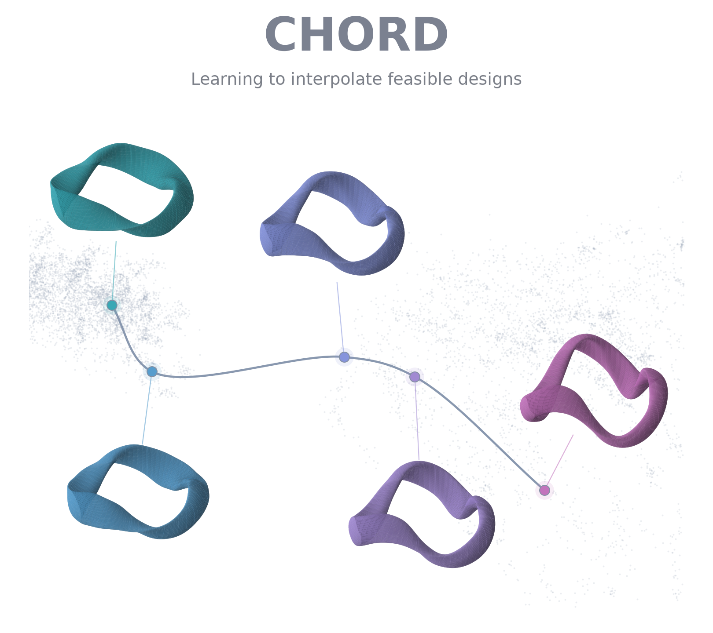

<p align="center">
  
</p>

CHORD combines a conditional VAE trained to penalize predicted constraint
violations along latent interpolants with self-consistent conditioning at
inference. These complementary ingredients support feasible design interpolation.
We assess stellarator feasibility against prescribed constraints using metrics
computed by the physics solver.

The problem it addresses: two designs can both satisfy a simulator's
constraints while every design decoded between them violates them. Training on
feasible endpoints does not make the path between them feasible, and naive
metric conditioning makes matters worse by asking the decoder for metric values
that no nearby latent code attains.

## Contents

| module | role |
|---|---|
| `chord.models` | encoder, decoder and the conditional VAE shared by all variants |
| `chord.feasibility` | constraint definitions and the chord regularizer |
| `chord.inference` | self-consistent conditioning, the inference-time half |
| `chord.train` | training loop, ELBO and the annealing schedules |
| `chord.surrogate` | differentiable stand-in for the simulator |
| `chord.evaluate` | simulator evaluation, delegated to constellaration |
| `chord.features` | invertible transform between Fourier coefficients and model inputs |
| `chord.corpus` | loading the published design corpus |
| `chord.artifacts` | artifact storage and the released surrogate |
| `chord.experiments.toy` | constructed benchmarks and the comparison that runs on them |
| `chord.experiments.frontfill.archive` | inference from the archived per-gap models |

Four variants are compared throughout, selected by two independent switches:
conditioning on a metric vector, and the chord regularizer during training.

| variant | conditional | chord regularizer |
|---|:---:|:---:|
| `vae` | no | no |
| `chord_unc` | no | yes |
| `cvae` | yes | no |
| `chord` | yes | yes |

## Install

This repository is a standalone Python package. Users need Python and the public
packages declared in `pyproject.toml`; no Proxima monorepo tools or dependencies
are required. Run these commands from the repository root:

```bash
python -m pip install -e .                 # the method
python -m pip install -e '.[toy]'           # adds CMA-ES for the constructed benchmarks
python -m pip install -e '.[stellarator]'   # ConStellaration 0.2.6 for VMEC evaluation
python -m pip install -e '.[huggingface]'   # Hugging Face artifact access
```

The `stellarator` extra pins `constellaration==0.2.6` for the paper's metric
definitions. See [REPRODUCING.md](REPRODUCING.md) for the benchmark tolerance and
the additional requirements for reproducing individual experiments.

On Ubuntu/Debian, the simulator extra may build `booz_xform` from source.
Install its C++ build tools and NetCDF C headers before the `stellarator` extra:

```bash
sudo apt-get update
sudo apt-get install -y build-essential cmake libnetcdf-dev
```

These are public system libraries; the core CHORD models do not need them.
See the [Boozer-transform installation guide](https://hiddensymmetries.github.io/booz_xform/getting_started.html)
for other platforms.

The offline tests also run with ordinary Python:

```bash
python -m pip install -e '.[dev,toy]'
python -m pytest
```

## Data

The datasets accompanying the paper are available on
[Hugging Face](https://huggingface.co/datasets/proxima-fusion/chord-paper).
They include a corpus of 100,000 stellarator boundaries spanning magnetic-axis
geometry at fixed aspect ratio, a 500,000-boundary surrogate-training subset,
optimization-campaign evaluations, and generated boundaries with solver evaluations
for the front-filling study. Trained models and their original normalization are
available there too. The larger historical datasets are available upon request
from [Santiago A. Cadena](mailto:scadena@proximafusion.com).

See [ARTIFACTS.md](ARTIFACTS.md) for dataset details and provenance, and
[REPRODUCING.md](REPRODUCING.md) for the reproduction workflows.

## Constructed benchmarks

Two problems with analytically known feasibility, where every claim about a
decoded design can be checked exactly and for free. The default C-shape is a connected annular corridor
with a forbidden inner disc and angular wedge in two dimensions. Shells has four
disconnected basins in sixteen dimensions. Sampled feasibility does not certify a
continuous feasible connection between those components.

```bash
python -m chord.experiments.toy.run --problem cshape
python -m chord.experiments.toy.run --problem shells
```

Each run generates a corpus, trains all four variants on it, and reports
feasibility along latent chords between held-out designs from different basins.
The optional `CShape(disc_radius=0.4)` extension adds a feasible inner disc. It
changes the benchmark topology and is not the C-shape experiment in the manuscript.

Interior statistics use the inclusive interval [0.3, 0.7], with one-ULP tolerance at
each edge. On a 21-point grid this includes nine points. The historical stellarator
tables used eight because floating-point comparison excluded 0.7000000000000001;
the manuscript documents that effective grid. Recomputed nine-point scores should
be labeled separately rather than compared as identical reproductions.

These commands exercise the implementation. See [REPRODUCING.md](REPRODUCING.md)
for the distinction between demonstrations, inference from saved paper models,
rescoring, and retraining.

## Saved paper models

Install the `huggingface` extra to load the archived fixed-aspect-ratio model and
physics surrogate directly:

```python
from chord import artifacts
from chord.experiments.stellarator import training

model = training.load_archived_model("fixed_ar/s0/z16/chord.pt")
predictor = artifacts.released_surrogate()
```

The checkpoint supplies the trained weights and its own preprocessing; using it
does not require the full surrogate-training dataset. See
[REPRODUCING.md](REPRODUCING.md) for raw-boundary encoding and decoding examples,
the model catalog, and the distinction between saved-model inference and retraining.

## Archived front models

The following command loads the paired model and generator inputs from Hugging Face:


```bash
python -m chord.experiments.frontfill.archive --gap g1 --model chord --out g1.npz
```

This interpolates encoded training anchors and writes unevaluated boundaries with
their endpoint indices. The default is the archived plain blend. Add
`--iterations 15` to run the archived self-consistency variant. These are separate
experimental settings, not interchangeable ways of reproducing one result.

The exploratory `frontfill.run build` command requires an explicit
`--source-corpus` with `source_campaign_aspect_ratio` provenance. It checks both
bracketing campaigns before starting simulations. The fixed-AR=7 corpus cannot
serve as this source.
